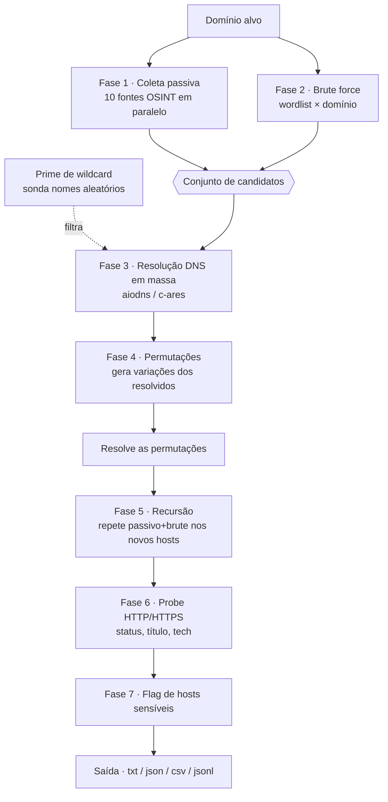

<div align="center">

# 🐺 subhound

### Enumeração de subdomínios robusta, assíncrona e *all-in-one* — em Python puro

*Coleta passiva (OSINT) · Brute force DNS · Permutações inteligentes · Resolução em massa com detecção de wildcard · Probe HTTP · Enumeração recursiva*


</div>

---

> ⚠️ **AVISO LEGAL**
> O `subhound` é uma ferramenta de **recon ofensivo**. Enumeração de subdomínios ativa (brute force, resolução, probe HTTP) toca em infraestrutura de terceiros. **Use exclusivamente em domínios que você possui ou para os quais tem autorização por escrito** (programa de bug bounty com escopo definido, contrato de pentest, laboratório próprio). Uso não autorizado pode configurar crime (no Brasil, Lei 12.737/2012 — "Lei Carolina Dieckmann" — e correlatas). Você é o único responsável pelo uso que fizer desta ferramenta.

---

## 📑 Índice

1. [Visão geral](#-visão-geral)
2. [Por que mais uma ferramenta de subdomínio?](#-por-que-mais-uma-ferramenta-de-subdomínio)
3. [Funcionalidades](#-funcionalidades)
4. [Arquitetura](#-arquitetura)
   - [O pipeline](#o-pipeline)
   - [Design concorrente](#design-concorrente-o-coração-da-performance)
   - [As camadas do código](#as-camadas-do-código)
   - [Modelo de dados](#modelo-de-dados)
5. [Como cada fase funciona por dentro](#-como-cada-fase-funciona-por-dentro)
6. [Instalação](#-instalação)
7. [Uso e referência da CLI](#-uso-e-referência-da-cli)
8. [Exemplos práticos](#-exemplos-práticos)
9. [Fontes passivas](#-fontes-passivas)
10. [Chaves de API](#-chaves-de-api-opcionais)
11. [Formatos de saída](#-formatos-de-saída)
12. [Tuning de performance](#-tuning-de-performance)
13. [Limitações conhecidas](#-limitações-conhecidas)
14. [Roadmap](#-roadmap)
15. [Troubleshooting / FAQ](#-troubleshooting--faq)
16. [Stack técnica](#-stack-técnica)
17. [Licença](#-licença)

---

## 🔭 Visão geral

`subhound` reúne, em um único binário Python, todo o fluxo que normalmente você encadearia com várias ferramentas separadas:

```
subfinder | dnsx | puredns | gotator | httpx
```

Em vez de amarrar cinco programas com pipes e arquivos temporários, o `subhound` executa o pipeline inteiro de forma coesa, com um modelo de dados compartilhado entre as fases, deduplicação inteligente e controle fino de concorrência.

O projeto é entregue em **duas formas equivalentes**:

| Forma | Arquivo | Quando usar |
|---|---|---|
| **Single-file** | `main.py` (~1.270 linhas) | Rodar rápido, estudar o código linear, levar pra qualquer lugar sem instalar |
| **Pacote modular** | `subhound/` (11 módulos) | Manter, estender, testar e empacotar como biblioteca |

As duas versões têm exatamente o mesmo comportamento — a single-file é a versão modular concatenada, com as wordlists embutidas como constantes.

---

## 🎯 Por que mais uma ferramenta de subdomínio?

O `subfinder` (Go) é excelente, mas é **passivo puro**: ele só consulta fontes e agrega. Para um reconhecimento completo você ainda precisa resolver os nomes, fazer brute force, gerar permutações e checar o que está vivo na web — cada etapa com uma ferramenta diferente.

O `subhound` não tenta ganhar do subfinder no jogo dele (throughput de coleta passiva em Go). Ele muda o ângulo: **entrega o pipeline inteiro**, e faz isso com inteligência em cada etapa (detecção de wildcard, permutações baseadas no que já foi descoberto, recursão, fingerprint de tecnologia).

| Recurso | `subfinder` | `subhound` |
|---|:---:|:---:|
| Coleta passiva (CT logs, OTX, etc.) | ✅ | ✅ |
| Brute force de DNS | ❌ | ✅ |
| Permutações (altdns / dnsgen) | ❌ | ✅ |
| Resolução DNS assíncrona em massa | parcial | ✅ |
| Detecção de wildcard DNS | ❌ | ✅ |
| Enumeração recursiva | ❌ | ✅ |
| Probe HTTP + título + fingerprint | ❌ | ✅ |
| Flag automática de hosts sensíveis | ❌ | ✅ |
| Saída txt / json / csv / jsonl | parcial | ✅ |

> **Trade-off honesto:** em coleta passiva pura e bruta, o Go do subfinder é mais rápido que qualquer coisa em Python com asyncio. A vantagem do subhound é **cobertura e conveniência do pipeline completo**, não velocidade de passivo isolado.

---

## ✨ Funcionalidades

- **10 fontes passivas de OSINT** — 8 funcionam sem nenhuma chave de API; 2 extras com chave para cobertura maior.
- **Brute force de DNS** com wordlist embutida (288 palavras) ou customizada.
- **Permutações inteligentes** estilo *altdns/dnsgen*: gera variações plausíveis a partir dos hosts já descobertos (`api` → `api-dev`, `api2`, `staging.api`…).
- **Resolução DNS assíncrona de alta vazão** via `aiodns` (c-ares), com rotação de 7 resolvers públicos, retries e controle de concorrência.
- **Detecção de wildcard DNS** por "pai", evitando toneladas de falso positivo.
- **Enumeração recursiva** com profundidade configurável.
- **Probe HTTP/HTTPS** dos hosts vivos: status, título, header `Server`, redirect e **fingerprint de tecnologia** (WordPress, Next.js, Django, Cloudflare…).
- **Flag automática** de subdomínios sensíveis (66 palavras-chave: `admin`, `vpn`, `jenkins`, `git`, `staging`…).
- **4 formatos de saída**: `txt`, `json`, `csv`, `jsonl`.
- **Saída colorida** com `rich` (fallback automático para ANSI simples).
- **Vários domínios de uma vez** via arquivo de lista.
- **Zero dependência pesada**: só `aiohttp`, `aiodns` e `rich`.

---

## 🏗️ Arquitetura

### O pipeline

O `subhound` é organizado como uma **esteira de fases**. Cada fase alimenta a próxima, e todas compartilham um mesmo dicionário `nome → Subdomain` que faz a deduplicação e a fusão de evidências (um host achado pela crt.sh **e** pelo brute guarda as duas origens).



Em texto, o fluxo linear:

```
   ┌─────────────┐   ┌─────────────┐
   │  PASSIVO    │   │   BRUTE     │
   │ (10 fontes) │   │ (wordlist)  │
   └──────┬──────┘   └──────┬──────┘
          └────────┬────────┘
                   ▼
          ┌─────────────────┐     ┌──────────────────┐
          │   RESOLUÇÃO     │◄────│ DETECÇÃO WILDCARD │
          │  (aiodns async) │     │  (filtra ecos)    │
          └────────┬────────┘     └──────────────────┘
                   ▼
          ┌─────────────────┐
          │  PERMUTAÇÕES    │ → resolve de novo
          └────────┬────────┘
                   ▼
          ┌─────────────────┐
          │    RECURSÃO     │ → passivo+brute nos filhos
          └────────┬────────┘
                   ▼
          ┌─────────────────┐
          │   PROBE HTTP    │ → status, título, tech
          └────────┬────────┘
                   ▼
          ┌─────────────────┐
          │  FLAG + SAÍDA   │
          └─────────────────┘
```

### Design concorrente (o coração da performance)

Todo o I/O do `subhound` é **assíncrono** (`asyncio`). Isso é o que permite resolver milhares de nomes e consultar dezenas de fontes "ao mesmo tempo" num único processo, sem threads nem bloqueio.

A concorrência é **limitada por semáforos** em cada subsistema, para não derrubar resolvers nem ser bloqueado pelas fontes:

| Subsistema | Mecanismo | Padrão | Flag |
|---|---|---:|---|
| Resolução DNS | `asyncio.Semaphore` no `Resolver` | 200 | `-t / --dns-concurrency` |
| Probe HTTP | `asyncio.Semaphore` no `HttpProber` | 50 | `--http-concurrency` |
| Fontes passivas | `asyncio.Semaphore` no `Engine` | 10 | `--source-concurrency` |

O padrão é: montar todas as tasks com `asyncio.gather(...)` e deixar o semáforo regular quantas correm de fato em paralelo. Se uma fonte ou um nome falha, o erro é capturado localmente e **nunca derruba as demais** — robustez acima de tudo.

### As camadas do código

Mesmo na versão single-file, o código é dividido em camadas bem separadas (na versão modular, cada uma é um arquivo):

| Camada | Módulo | Responsabilidade |
|---|---|---|
| **Configuração** | `config.py` | Constantes, resolvers padrão, palavras-chave sensíveis, leitura de chaves de API via ambiente, `Settings` |
| **Modelo** | `models.py` | `Subdomain` e `ProbeResult` (dataclasses com `merge` e `to_dict`) |
| **Apresentação** | `console.py` | Saída colorida (`rich`), banner, separação stdout/stderr |
| **Fontes** | `sources.py` | Classe base `PassiveSource` + 10 fontes + registro |
| **Resolução** | `resolver.py` | `Resolver` assíncrono sobre `aiodns` |
| **Anti-FP** | `wildcard.py` | `WildcardDetector` |
| **Geração** | `permutations.py`, `bruteforce.py` | Candidatos de brute e permutações |
| **Verificação web** | `http_probe.py` | `HttpProber` + fingerprint |
| **Saída** | `output.py` | Writers txt/json/csv/jsonl |
| **Orquestração** | `engine.py` | `Engine` + `EngineConfig` — amarra todas as fases |
| **Interface** | `cli.py` | `argparse`, parsing de domínios/resolvers, despacho |

> **Decisão de design:** manter apresentação (`console`) separada da lógica (`engine`). As mensagens de status vão para **stderr**, e só os subdomínios vão para **stdout** — assim você pode fazer `subhound alvo.com -s | httpx` sem poluir o pipe.

### Modelo de dados

O estado inteiro da execução vive em dois `dataclasses`:

```python
@dataclass
class Subdomain:
    name: str
    sources: Set[str]       # de onde veio: {crtsh, brute, permutation...}
    ips: Set[str]           # registros A/AAAA
    cname: Optional[str]
    resolved: bool
    wildcard: bool          # marcado se for eco de wildcard
    depth: int              # nível na recursão
    interesting: bool       # bateu palavra-chave sensível
    probe: Optional[ProbeResult]

@dataclass
class ProbeResult:
    url: str; status: int; scheme: str
    title: Optional[str]; server: Optional[str]
    content_length: Optional[int]; content_type: Optional[str]
    redirect: Optional[str]; tech: List[str]
```

O método `Subdomain.merge()` é o que garante **deduplicação com fusão de evidências**: quando o mesmo host aparece em duas fases, as origens e IPs se unem em vez de criar registros duplicados.

---

## 🔬 Como cada fase funciona por dentro

### 1. Coleta passiva

Cada fonte herda de `PassiveSource` e implementa `fetch(session, domain, settings) → set[str]`. Todas rodam em paralelo sobre uma única `aiohttp.ClientSession`, com timeout por fonte. Os hostnames são extraídos com um regex genérico de domínio e **filtrados** para pertencerem ao alvo (descarta curinga `*.`, credenciais `user@host`, e hosts de outros domínios). Fontes com chave ausente se **auto-desabilitam**.

### 2. Brute force

Monta `palavra.dominio` para cada palavra da wordlist (embutida: 288; ou a sua via `-w`) e joga no resolver. É só geração de candidatos — a resolução acontece na fase 3.

### 3. Resolução DNS

O `Resolver` usa `aiodns` (binding do **c-ares**, a mesma lib C que o nmap e o curl usam). Para cada nome, consulta **A**, **AAAA** e, se não houver IP, **CNAME**. Características:

- **Rotação de resolvers**: 7 resolvers públicos (Cloudflare, Google, Quad9, OpenDNS, Verisign), escolhidos aleatoriamente por query para distribuir carga.
- **Retries** configuráveis, com short-circuit em `NXDOMAIN` (não adianta repetir).
- **Semáforo** de 200 resoluções simultâneas por padrão.

### 4. Detecção de wildcard

Domínios com `*` no DNS respondem **qualquer** subdomínio com o mesmo IP — o que geraria lixo infinito no brute. O `WildcardDetector`:

1. Sonda 3 nomes **aleatórios** (`subhound-<hex>.alvo.com`) que não deveriam existir.
2. Se eles resolverem, guarda os IPs → esse é o "conjunto wildcard" daquele pai.
3. Qualquer host cujos IPs sejam **subconjunto** do wildcard é marcado como eco e descartado.

A detecção é **por pai** e cacheada — `*.dev.alvo.com` pode existir mesmo sem `*.alvo.com`.

### 5. Permutações

A sacada: ambientes reais seguem padrões. A partir dos hosts **já resolvidos**, o gerador cria variações plausíveis com as 66 palavras de ambiente embutidas:

- Antepõe palavra: `api.v2` → `dev.api.v2`
- Mutações label a label: `api` → `api-dev`, `dev-api`, `apidev`, `devapi`, `dev`
- Mutações numéricas: `api` → `api1`, `api2`, `api01`; `api1` → `api2`, `api0`

Tudo com um limite rígido (`perm_limit`, padrão 50.000) para não explodir. As permutações passam pela mesma resolução + filtro de wildcard.

### 6. Recursão

Para cada subdomínio resolvido, repete passivo (+ brute, se ligado) tratando-o como domínio-alvo, até `--depth` níveis. Candidatos já conhecidos são subtraídos a cada rodada para não repetir trabalho.

### 7. Probe HTTP

O `HttpProber` tenta **HTTPS e depois HTTP** em cada host vivo (`ssl=False` para ignorar cert inválido, sem seguir redirect automático). Lê até 64 KB do corpo e extrai:

- **Status** e **esquema** que respondeu
- **Título** da página (via regex)
- Header **Server** e **Content-Type/Length**
- **Location** do redirect
- **Fingerprint de tecnologia** por headers (`X-Powered-By`, `X-Generator`…) e marcadores no corpo (`wp-content` → WordPress, `__NEXT_DATA__` → Next.js, `csrfmiddlewaretoken` → Django, `cf-ray` → Cloudflare, etc.)

### 8. Flag de hosts sensíveis

Os labels de cada host são cruzados com 66 palavras-chave (`admin`, `vpn`, `jenkins`, `git`, `staging`, `phpmyadmin`…). Bateu → `interesting = True`. Combine com `--interesting-only` para focar no que importa num pentest.

---

## 📦 Instalação

Requer **Python 3.9+**.

### Versão single-file (recomendada para rodar)

```bash
# baixe o main.py e instale as 3 dependências
pip install aiohttp aiodns rich
python3 main.py --help
```

### Versão modular (como pacote/comando)

```bash
cd subhound
pip install -r requirements.txt
# ou, para instalar o comando `subhound` no PATH:
pip install -e .
subhound --help
```

> **Nota sobre `aiodns`:** ele usa `pycares` (binding de c-ares). Em distros Debian/Ubuntu, se a instalação reclamar de compilação, instale as ferramentas de build:
> ```bash
> sudo apt install build-essential python3-dev
> ```

---

## 🛠️ Uso e referência da CLI

```
python3 main.py <domínio> [opções]
python3 main.py -l dominios.txt [opções]
```

### Fases

| Flag | Descrição |
|---|---|
| `-a, --all` | Liga **brute + permutações + recursão + probe** de uma vez |
| `--no-passive` | Pula a coleta passiva |
| `-b, --brute` | Ativa brute force de DNS |
| `-p, --permutations` | Gera permutações dos hosts encontrados |
| `-r, --recursive` | Enumeração recursiva |
| `--depth N` | Profundidade da recursão (padrão: 1) |
| `--probe` | Probe HTTP/HTTPS nos hosts vivos |
| `--no-resolve` | Não resolve no DNS (apenas dump passivo) |

### Wordlists

| Flag | Descrição |
|---|---|
| `-w, --wordlist FILE` | Wordlist para o brute (padrão: embutida, 288 palavras) |
| `--perm-wordlist FILE` | Palavras para permutações (padrão: embutida, 66 palavras) |

### Fontes passivas

| Flag | Descrição |
|---|---|
| `--sources LISTA` | Usa **só** estas fontes (separadas por vírgula) |
| `--exclude-sources LISTA` | Exclui estas fontes |
| `--list-sources` | Lista as fontes disponíveis e sai |

### Performance

| Flag | Padrão | Descrição |
|---|---:|---|
| `-t, --dns-concurrency N` | 200 | Resoluções DNS simultâneas |
| `--http-concurrency N` | 50 | Probes HTTP simultâneos |
| `--source-concurrency N` | 10 | Fontes passivas simultâneas |
| `--dns-timeout S` | 4.0 | Timeout por query DNS |
| `--http-timeout S` | 8.0 | Timeout por probe |
| `--source-timeout S` | 25.0 | Timeout por fonte passiva |
| `--retries N` | 2 | Retries por query DNS |
| `--resolvers X` | 7 públicos | Resolvers (lista por vírgula ou arquivo) |

### Saída

| Flag | Descrição |
|---|---|
| `-o, --output FILE` | Salva subdomínios em `.txt` |
| `-oj, --json FILE` | Salva resultado completo em `.json` |
| `-oc, --csv FILE` | Salva em `.csv` |
| `--jsonl FILE` | Salva em JSON-lines |
| `--only-resolved` | Só os que resolveram |
| `--interesting-only` | Só os marcados como sensíveis |
| `--probe-only` | Só os que responderam no probe |

### Geral

| Flag | Descrição |
|---|---|
| `-v, --verbose` | Saída detalhada |
| `-s, --silent` | Só imprime subdomínios (sem banner/status) |
| `--no-color` | Desliga cores |
| `-V, --version` | Mostra a versão |

---

## 💡 Exemplos práticos

```bash
# 1. Recon passivo simples (resolve e mostra quem está vivo)
python3 main.py exemplo.com

# 2. Tudo ligado + salva JSON completo
python3 main.py exemplo.com -a -oj resultado.json

# 3. Brute com wordlist grande (ex.: SecLists) + probe, salvando CSV
python3 main.py exemplo.com -b -w ~/wordlists/dns-Jhaddix.txt --probe -oc out.csv

# 4. Vários domínios, recursivo com profundidade 2
python3 main.py -l dominios.txt -r --depth 2 -o subs.txt

# 5. Só passivo, sem tocar no DNS (modo "stealth")
python3 main.py exemplo.com --no-resolve

# 6. Só as fontes de CT logs, pipe pro httpx
python3 main.py exemplo.com -s --sources crtsh,certspotter | httpx -silent

# 7. Foco em pentest: só hosts sensíveis que estão vivos na web
python3 main.py exemplo.com -a --interesting-only --probe-only

# 8. Performance agressiva (cuidado com rate limit)
python3 main.py exemplo.com -b -t 500 --dns-timeout 2
```

---

## 🌐 Fontes passivas

**Sem chave (funcionam de cara):**

| Fonte | Tipo | O que agrega |
|---|---|---|
| **crt.sh** | Certificate Transparency | Uma das melhores fontes free |
| **HackerTarget** | DNS/host search | Tier free |
| **RapidDNS** | Base histórica de DNS | HTML parseado |
| **AlienVault OTX** | Passive DNS | Threat intel |
| **Anubis (jldc.me)** | Agregador comunitário | — |
| **Wayback Machine** | URLs arquivadas (CDX) | Subdomínios em URLs antigas |
| **CertSpotter** | Certificate Transparency | Mais CT logs |
| **ThreatMiner** | Threat intel | — |

**Com chave (cobertura maior):**

| Fonte | Variável de ambiente |
|---|---|
| **VirusTotal** | `VIRUSTOTAL_API_KEY` |
| **SecurityTrails** | `SECURITYTRAILS_API_KEY` |

Liste tudo com `python3 main.py --list-sources`.

---

## 🔑 Chaves de API (opcionais)

As fontes com chave se ativam sozinhas quando a variável de ambiente existe:

```bash
export VIRUSTOTAL_API_KEY="sua_chave_aqui"
export SECURITYTRAILS_API_KEY="sua_chave_aqui"

python3 main.py exemplo.com     # VT e SecurityTrails entram automaticamente
```

Sem as chaves, o `subhound` roda normalmente com as 8 fontes gratuitas.

---

## 📄 Formatos de saída

### `txt` (`-o`)
Um subdomínio por linha — ideal para pipe.

### `json` (`-oj`)
Resultado completo com metadados da execução:

```json
{
  "domain": "exemplo.com",
  "meta": { "duration_sec": 12.4, "brute": true, "probe": true },
  "count": 142,
  "results": [
    {
      "subdomain": "api.exemplo.com",
      "sources": ["crtsh", "brute"],
      "ips": ["203.0.113.10"],
      "cname": null,
      "resolved": true,
      "interesting": true,
      "http": {
        "url": "https://api.exemplo.com",
        "status": 200,
        "title": "API Gateway",
        "server": "nginx",
        "tech": ["nginx", "Cloudflare"]
      }
    }
  ]
}
```

### `csv` (`-oc`)
Planilha com colunas: `subdomain, ips, cname, sources, interesting, http_status, http_title, tech`.

### `jsonl` (`--jsonl`)
Uma linha JSON por subdomínio — perfeito para `jq` e pipelines de dados.

---

## ⚡ Tuning de performance

- **Mais velocidade:** suba `-t` (ex.: `-t 500`) e reduza `--dns-timeout` (ex.: `2`). Cuidado: resolvers públicos têm rate limit; se começar a dar timeout demais, use seus próprios resolvers com `--resolvers`.
- **Resolvers dedicados:** para listas enormes, rodar um resolver local (ex.: `dnsmasq`/`unbound`) e apontar `--resolvers 127.0.0.1` reduz muito a perda por rate limit.
- **Menos barulho na rede:** `--source-concurrency 5` e `--dns-concurrency 100` deixam a varredura mais discreta.
- **Brute pesado:** o gargalo é o DNS, não a CPU. Wordlists de 100k+ palavras funcionam; ajuste `-t` conforme a tolerância dos resolvers.

---

## 🚧 Limitações conhecidas

- **Não vence o subfinder em passivo puro.** Python + asyncio perde para Go em throughput bruto de coleta. A vantagem aqui é o pipeline completo.
- **Rate limit das fontes free.** Algumas fontes (HackerTarget, VirusTotal sem chave paga) limitam requisições. O subhound degrada graciosamente — uma fonte que falha não derruba as outras.
- **Detecção de wildcard é heurística.** Hosts legítimos que compartilham IP com o wildcard podem ser descartados. Em alvos com CDN pesada, revise manualmente.
- **Fingerprint de tecnologia é básico.** Cobre os casos comuns; não substitui o Wappalyzer/`httpx -td`.
- **IDN/punycode** não tem tratamento especial.

---

## 🗺️ Roadmap

Ideias para as próximas versões (boas também como conteúdo de canal):

- [ ] **Detecção de subdomain takeover** (encaixa direto no probe — CNAME órfão + assinatura de serviço).
- [ ] **Screenshot** dos hosts vivos (headless Chromium).
- [ ] **Saída em tempo real** (streaming estilo `httpx`), em vez de só no final.
- [ ] **Mais fontes** com chave: Shodan, Censys, Chaos, FullHunt.
- [ ] **Resolução de porta/serviço** além do HTTP.
- [ ] **Modo "diff"** para monitoramento contínuo (comparar execuções).
- [ ] Empacotamento no **PyPI** (`pip install subhound`).

---

## 🩺 Troubleshooting / FAQ

**"Resolve 0 subdomínios, mas o domínio existe."**
Verifique se a rede permite DNS de saída (UDP 53). Em alguns sandboxes/corporativos o 53 é bloqueado — nesse caso use `--resolvers` apontando para um resolver permitido, ou rode em outra rede.

**"`aiodns` não instala."**
Instale as ferramentas de build: `sudo apt install build-essential python3-dev`. No Windows, use o Python oficial (os wheels já vêm prontos).

**"Muitos timeouts no brute."**
Você provavelmente bateu no rate limit dos resolvers públicos. Reduza `-t`, aumente `--dns-timeout`, ou use resolvers dedicados com `--resolvers`.

**"As cores ficam estranhas / quero saída limpa."**
Use `--no-color`, ou `-s` para imprimir só os subdomínios no stdout.

**"Quero usar numa automação."**
`python3 main.py alvo.com -s` → só os nomes no stdout. Combine com `--jsonl` para dados estruturados.

---

## 🧰 Stack técnica

| Componente | Tecnologia |
|---|---|
| Linguagem | Python 3.9+ |
| Concorrência | `asyncio` (nativo) |
| HTTP assíncrono | `aiohttp` |
| DNS assíncrono | `aiodns` (binding de **c-ares**) |
| Terminal | `rich` (com fallback ANSI) |
| CLI | `argparse` |
| Dados | `dataclasses` |

**Números do projeto:** ~1.270 linhas · 10 fontes OSINT · 288 palavras de brute · 66 de permutação · 66 palavras-chave sensíveis · 7 resolvers padrão.

---

## 📜 Licença

Distribuído sob a licença **MIT**. Use, modifique e compartilhe livremente — mantendo o aviso de copyright e **sempre dentro da lei e da ética**.

---

<div align="center">


[GitHub](https://github.com/Kalyel473) · Hacking ético, bug bounty e ferramentas em Python

*Feito para quem estuda ofensivo de verdade. Use com responsabilidade.*

</div>
